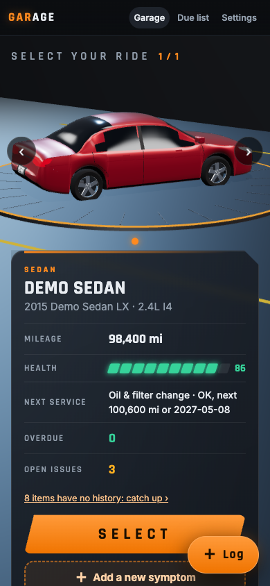
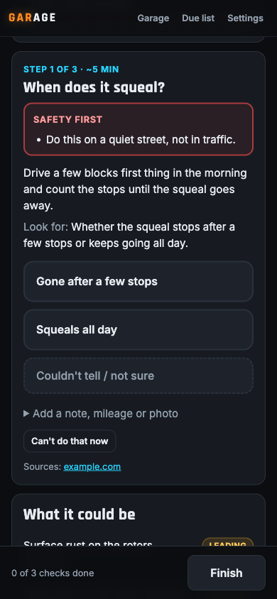
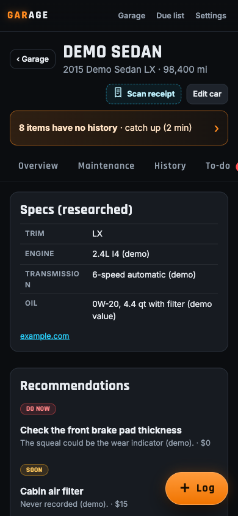
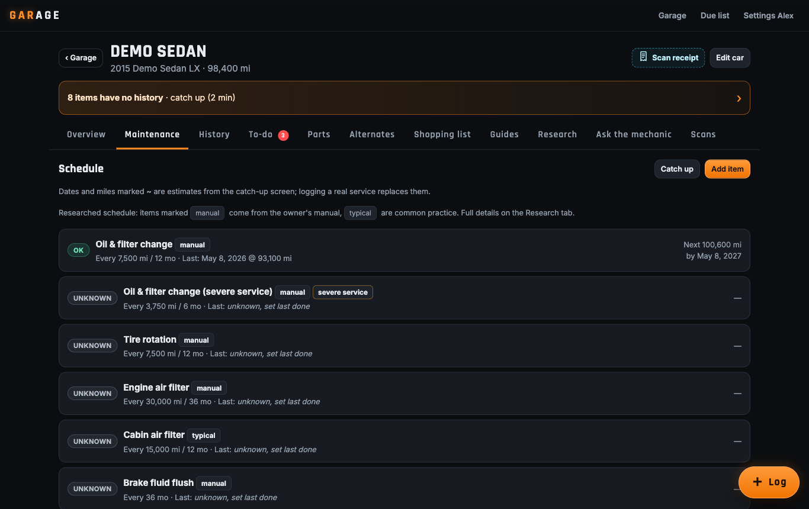

# Garage

A vehicle-maintenance app for your household (cars, trucks, motorcycles, side-by-sides and ATVs), styled like a video-game garage. It runs on **your own** Cloudflare
account or **your own** server (Docker, Unraid), and **your own** Claude sets it up, adds your cars and researches them.

<p>



</p>


*(Screenshots from the built-in demo car; all its data is made up.)*

**What it does:** maintenance schedules with what's due (by miles, engine hours or date, whichever comes first), starter
schedules for cars, motorcycles (chain / shaft / belt, carbs, air- or liquid-cooled), UTVs and ATVs, catch-up for unknown
history, one-tap service logging,
symptoms with a quick "first things to check" from an AI mechanic, guided step-by-step diagnosis, receipts read
from a photo, parts and brand alternates with a shopping list (RockAuto for cars, Partzilla / RevZilla / Rocky Mountain
for bikes and off-road), repair guides, researched recalls / TSBs / known issues plus live NHTSA and CPSC recall lookups,
the JASO MA/MA2 oil warning for wet-clutch bikes, a chat with an AI mechanic that knows your vehicle, and a 3D garage
(six car body styles plus cruiser, sport, dual-sport and scooter motorcycles, a UTV and an ATV, in your paint color, or
upload your own .glb). Claude can use all of it through the built-in MCP connector: claude.ai, the Claude phone apps, Claude
Desktop and Claude Code. Full list: [docs/features.md](docs/features.md).

## Choose how to host

| | **Cloudflare** (the original) | **Docker / Unraid** |
|---|---|---|
| Runs on | your free Cloudflare account (Workers, D1, KV) | your own machine: `docker run`, Compose, or the Unraid template |
| Public HTTPS (for Claude connectors and iPhone notifications) | built in (`*.workers.dev` or your domain) | add one: Cloudflare Tunnel, Tailscale Funnel or a reverse proxy |
| AI (mechanic, first checks, receipts) | Workers AI on your account (free daily allowance) | your choice: Ollama / any OpenAI-compatible server, the Claude API, Workers AI over REST, or off |
| Email-in | Cloudflare Email Routing on your domain | IMAP polling of a mailbox |
| Data | in your Cloudflare account | in one folder (`/data`) on your machine |
| Updates | `git pull` + deploy (the update skill) | pull the new image; migrations run by themselves, with a backup first |

Both run the same app code. Docker images are published for every [release](https://github.com/Taylorshome/garage-kit/releases)
at `ghcr.io/taylorshome/garage-kit` (amd64 + arm64). Docker details: [docs/docker.md](docs/docker.md).

## Get started

1. Clone this repo.
2. Open [Claude Code](https://claude.com/claude-code) in the folder.
3. Say **"set up my garage"** (or "set up my garage with Docker").

For Cloudflare, Claude checks Node, logs you in to your Cloudflare account (`wrangler login`), asks a few questions
(name, sign-in, optional extras), creates the database, deploys, connects itself to the app, and then helps you add
your first car and research it. For Docker it writes a compose file and settings with you, starts the container and
helps you set up HTTPS. Nothing goes through anyone else's account, server or Claude subscription.

Docker without Claude Code:
```bash
docker run -d --name garage-kit -p 8787:8787 -v "$PWD/garage-data:/data" \
  -e TZ=America/Chicago -e GARAGE_PASSWORD='a-long-household-password' ghcr.io/taylorshome/garage-kit:0.2
```

Want to look first? `npm ci && npm run demo` runs it locally with demo vehicles: a made-up sedan, a V Star 650
motorcycle and a side-by-side on engine hours (see [docs/development.md](docs/development.md)).

## What it costs

On Docker: your own hardware, plus whatever AI provider you pick (Ollama on your own machine is free). On Cloudflare:

- **Cloudflare Workers free plan** is plenty for a household: 100,000 requests/day, D1 and KV free tiers. The
  Workers Paid plan ($5/month) is only needed for heavy use.
- **Workers AI** (the in-app mechanic, the first-checks note, reading receipt photos) runs on your account. The free
  daily allowance (10,000 neurons/day when this was written;
  [current pricing](https://developers.cloudflare.com/workers-ai/platform/pricing/)) covers light use; past it, AI
  calls fail until the next day unless you're on Workers Paid.
- **Research** is done by your own Claude (Claude Code or a Claude app), so it uses your Claude plan.
- A custom domain is optional (only needed for email-in).

## Optional pieces (all off by default)

| Piece | What you need |
|---|---|
| Sign-in: household password (default), Cloudflare Access, your own OIDC provider, or none (with loud warnings) | nothing extra for the password |
| Notifications (web push): due reminders, monthly mileage (or engine hours) check, research results | nothing; on iPhone add the app to the Home Screen |
| Email-in: forward receipts and scan-tool reports | Cloudflare: your own domain + Email Routing. Docker: an IMAP mailbox |
| Home Assistant notifications and a "due" sensor | Cloudflare: HA reachable from the internet (Nabu Casa or a Cloudflare Tunnel). Docker: HA on your LAN is fine |
| Automatic research of every new symptom | an always-on computer (Mac, Linux box, Raspberry Pi) with Claude Code |

Details: [docs/integrations.md](docs/integrations.md), [docs/research-worker.md](docs/research-worker.md), [docs/docker.md](docs/docker.md).

What changed in each version: [CHANGELOG.md](CHANGELOG.md).

## Disclaimer

**Not professional advice. This information comes from AI and online research, not a certified mechanic. Verify
before acting, follow safety precautions, and do all work at your own risk.**

The app shows this on every page, asks each person to acknowledge it once, and tells Claude to mention it when
giving repair guidance. Research and AI answers can be wrong, out of date or about a different engine or trim: check
part numbers and specs for your exact vehicle (VIN), use jack stands, and see a professional when in doubt.

## License

[MIT](LICENSE). Provided **as is, without warranty of any kind**; you use it, and do any work on your vehicles, at
your own risk. Third-party components and their licenses: [THIRD_PARTY_LICENSES.md](THIRD_PARTY_LICENSES.md).
